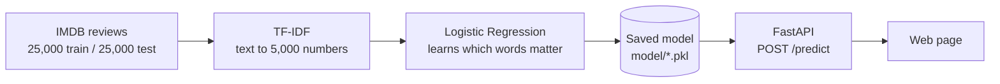

# Sentiment Analysis API

Type a movie review, get back **positive** or **negative** with a confidence score.

A small but complete machine learning pipeline: train, evaluate, save, serve.

**Result: 88.26% accuracy on 25,000 reviews the model never saw during training.**

## How it works



**Step 1: turn text into numbers (TF-IDF).** A classifier cannot read words, so each review becomes a list of 5,000 numbers, one per word in the vocabulary (the 5,000 most frequent words in the training reviews). A word scores high when it appears often in *this* review but rarely across all reviews. So "the" scores low and "terrible" scores high.

**Step 2: learn from labelled examples (Logistic Regression).** The model learns a weight for each word: "awful" pushes toward negative, "brilliant" pushes toward positive. For a new review it adds up the weights and converts the total into a probability. That probability is the confidence you see.

## Results

Evaluated on the 25,000 held-out test reviews:

| | Predicted negative | Predicted positive |
|---|---:|---:|
| **Actually negative** | 11,012 | 1,488 |
| **Actually positive** | 1,446 | 11,054 |

22,066 of 25,000 correct. The two kinds of mistake are almost equal (1,488 vs 1,446), so the model is not biased toward either sentiment.

## Run it

You need Python 3.10+.

```bash
git clone https://github.com/yousseframy1/sentiment-analysis-api.git
cd sentiment-analysis-api

pip install -r requirements.txt
pip install notebook

jupyter notebook notebooks/train_model.ipynb    # run all cells: trains and saves the model
uvicorn app.main:app --reload
```

The trained model files are not stored in the repository, so run the notebook once before starting the API. Then open `frontend/index.html` in your browser, or try the API at `http://localhost:8000/docs`.

## API

**`POST /predict`**

```json
{ "text": "This movie was amazing!" }
```

Example response (the exact confidence will vary):

```json
{
  "text": "This movie was amazing!",
  "sentiment": "positive",
  "confidence": 0.94
}
```

`GET /` returns a status message.

## Limitations

- **Ignores word order.** The model sees a bag of words, so negation and sarcasm ("not good", "what a masterpiece, I fell asleep") can fool it.
- **Movie reviews only.** It learned from IMDB, so expect weaker results on other kinds of text.
- **Two classes.** There is no "neutral" label.
- **Pickle files.** Only load model files you created yourself, and use the pinned `scikit-learn` version, since pickles can break across versions.

## Possible improvements

- Include word pairs (n-grams) so phrases like "not good" are captured
- Compare against other models and report the results side by side
- Add automated tests for the API
- Package it with Docker so it runs the same everywhere

## Project layout

```
notebooks/train_model.ipynb   loads data, trains, evaluates, saves the model
app/model_utils.py            loads the model and makes predictions
app/main.py                   FastAPI endpoints
frontend/index.html           minimal test page
model/                        saved model (created by the notebook, not committed)
```

**Built with:** Python, FastAPI, scikit-learn, Hugging Face `datasets`

## Contact

Youssef Ramy · yousseframy200@gmail.com · [GitHub](https://github.com/yousseframy1) · [LinkedIn](https://www.linkedin.com/in/youssef-ramy-73a21a305/)
